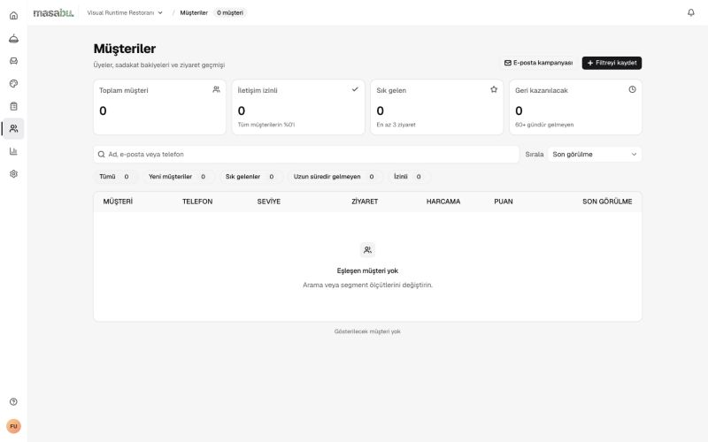
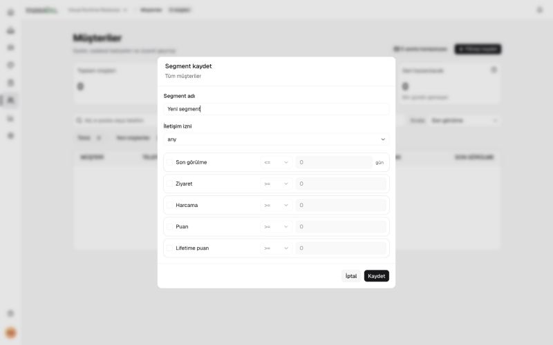
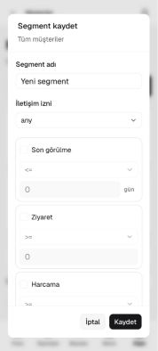
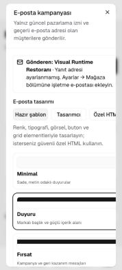
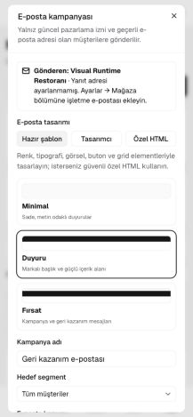
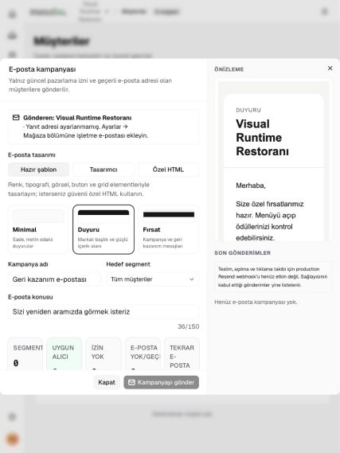
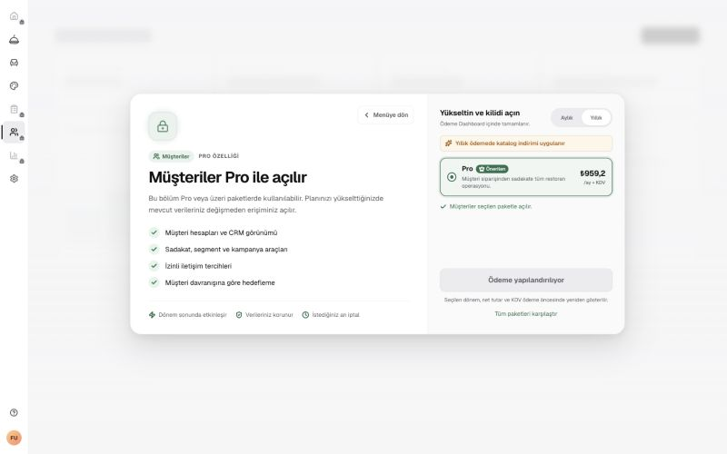
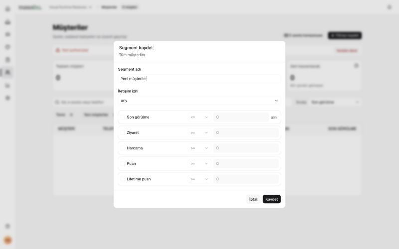

# Müşteriler — UI/UX ve teknik audit · 6 Eylül 2026

Kaynak commit: `a91709110d425601b022b8ada15e9f783da36bc4`. Bu çalışma yalnız audit: ürün kodu, şema, müşteri kaydı, puan veya kampanya değiştirilmedi; e-posta gönderilmedi. Öncelik tasarımı değiştirmek değil, mobil erişimi ve işlem güvenilirliğini düzeltmek.

Uygulama sonuçları ve yeni ekran kanıtları: [Düzeltme raporu](implementation.md). Aşağıdaki audit bulguları başlangıç commitindeki durumu anlatır.

## Kapsam ve kanıt sınırları

1. **Boş müşteri listesi:** erişildi; temel hiyerarşi anlaşılır, ilk müşteri edinme yönlendirmesi eksik. Arama yokken bile “Arama veya segment ölçütlerini değiştirin” yazıyor.
2. **Segment hazırlama:** masaüstü ve 320 px erişildi; Kaydet/İptal görünür, alan isimleri ve taslak koruması sorunlu.
3. **Kampanya hazırlama:** 320/390/768 px erişildi; mobil kaydırma engeli doğrulandı. Kampanya taslağının Escape ile kaybı yeniden açılarak doğrulandı. Gönderim yapılmadı.
4. **Plan kapısı:** MAF işletmesinde müşteri listesi Pro paneli gösterdi. Salt okunur DEV sorgusunda bu işletmede 6 müşteri var; detay rotası kodu incelendi.
5. **Dolu liste / müşteri detayı / puan işlemi:** görsel akış tamamlanamadı. Erişilebilir iki test işletmesi boş, dolu MAF işletmesinin mevcut planı CRM’i kapatıyor. Plan değiştirilmedi. Bu adımlar geçmiş kanıtlarla veya veri tabanı sonucu ile görsel olarak geçmiş sayılmadı.

CSS viewport DOM üzerinden doğrulandı: 320×711, 390×844, 768×1024, 1440×900. Tarayıcı mevcut zoom ölçeği nedeniyle override boyutları bu CSS ölçülerine göre ayarlandı. Screenshot sağlayıcısının çevrede ürettiği boş tuval, screenshot API clip alanıyla dışarıda bırakıldı; görüntü içeriği değiştirilmedi. 01 numaralı ilk görüntüde boş tuval mevcut, bulgular sonraki görüntülere dayanıyor. Kontrol sonunda viewport override sıfırlandı.

Klavye Escape ve odak geri dönüşü kontrol edildi. %200 zoom, ekran okuyucu ile tam tarama, azaltılmış hareketin gerçek cihaz karşılaştırması, kontrollü ağ kesintisi, iki oturumlu yazma ve gerçek gönderim bu auditin doğrulanmış kapsamı değil.

## Korunacak güçlü yönler

- Ortak Dialog/AlertDialog kullanımı; segment penceresinin mobil alt işlemleri erişilebilir ve 320 px’de yatay taşma yok.
- Müşteri okumalarında tenant/bölüm erişimi, sahip olmayan üyelerde iletişim verilerinin maskelenmesi; manuel puan ve kampanya gönderiminin owner-only sunucu kontrolü mevcut.
- Manuel puan ve kampanya gönderiminde requestId temelli tekrar deneme mekanizması mevcut; yeniden yazılmamalı, pending alan değişiklikleri ayrıca davranış testiyle sınanmalı.
- Liste araması geciktiriliyor, eski yanıtlar sequence ile ayıklanıyor; hata yeniden deneme ve online geri dönüşü var. Debounce penceresinde eski yanıtın kısa süreli yerleşme olasılığı cleanup sırasında geçersizleştirmeyle ayrıca kapatılabilir.
- Müşteri hareketleri imleçle sayfalanıyor; istemci tekrar gelen event id’lerini ayıklıyor. Test ve kaynak kanıtı var, bu turda dolu hareket listesi çalıştırılmadı.
- Özet veriler ilk listenin sunucu kritik yolundan ayrılmış; Türkçe isim/telefon araması ve kararlı customer_id sıralaması veritabanında mevcut.

## Önceliklendirilmiş bulgular

P0 doğrulanmadı. Aşağıdaki P1 bulgular lansman öncesi ele alınmalı; kod bulguları açıkça ayrıca işaretli.

### C01 · P1 — Mobil kampanya formunun altı kesiliyor

**Etki:** 320 CSS px / 711 px yükseklikte dialog 691 px, iç panel 2181 px. Panel kendi içeriği kadar büyüyor; dış dialog overflow:hidden. Kapat düğmesi y=1553 px konumunda; iki sayfalık kaydırma sonrasında değişmedi. 390 px ekranında da alt alanlar görünmüyor. İşletmeci telefondan formu tamamlayamıyor.

**Kanıt:** [CustomersClient.tsx:1082](/Users/furkancengelm3/dev/gersonless/apps/dashboard/components/customers/CustomersClient.tsx:1082); [CustomersClient.tsx:1334](/Users/furkancengelm3/dev/gersonless/apps/dashboard/components/customers/CustomersClient.tsx:1334); 06/07/08 ekranları. **Doğrulama türü:** Tarayıcı + kaynak.

**Çözüm:** Tek bir sınırlandırılmış kaydırma alanı oluştur; grid/flex çocuklarına min-height:0 uygula, alt işlem alanını görülebilir tut. **Efor:** 0,5 gün.

**Kabul:** 320/390 px ve kısa ekranda bütün alanlar, önizleme ve gönderim düğmesine parmakla/klavyeyle erişilebilsin; dialog dışı sayfa kaymasın.

### C02 · P1 — Segment ve kampanya taslakları uyarısız kayboluyor

**Etki:** Segment adı ve kampanya adı değiştirildikten sonra Escape pencereyi kapatıyor; yeniden açılışta varsayılan ad geliyor. İki akışta da değişiklikleri bırakma uyarısı çıkmadı. Uzun kampanya metni/tasarımı kaybedilebilir.

**Kanıt:** [CustomersClient.tsx:1081](/Users/furkancengelm3/dev/gersonless/apps/dashboard/components/customers/CustomersClient.tsx:1081); [CustomersClient.tsx:1482](/Users/furkancengelm3/dev/gersonless/apps/dashboard/components/customers/CustomersClient.tsx:1482). **Doğrulama türü:** Tarayıcı + kaynak.

**Çözüm:** Mevcut menü taslak/navigasyon korumasının ortak yaklaşımını kullan. Escape, dış tıklama, X ve bölüm geçişlerini kapsa; kayıt/gönderim sürerken çıkışı engelle. **Efor:** 0,5–1 gün.

**Kabul:** İptal edilen çıkışta bütün alanlar kalsın; yalnız açık bırakma onayı taslağı silsin. Gönderim yapmadan test edilsin.

### C03 · P1 — Segment kaydında beklenmeyen hatadan kurtarma eksik

**Etki:** handleSaveSegment saving=true yapıyor; await çevresinde catch/finally bulunmuyor. Ağ/Server Action reddi saving durumunu açık bırakabilir; dialog kapatma ve düğmeler de bu değere bağlı. Silme yolunda da catch, pending kilidi ve hatada açık kalan onay akışı eksik.

**Kanıt:** [CustomersClient.tsx:322](/Users/furkancengelm3/dev/gersonless/apps/dashboard/components/customers/CustomersClient.tsx:322); [CustomersClient.tsx:344](/Users/furkancengelm3/dev/gersonless/apps/dashboard/components/customers/CustomersClient.tsx:344); [CustomersClient.tsx:730](/Users/furkancengelm3/dev/gersonless/apps/dashboard/components/customers/CustomersClient.tsx:730). **Doğrulama türü:** Kaynak; gerçek hata enjeksiyonu yapılmadı.

**Çözüm:** try/catch/finally, aynı anda tek istek kilidi ve taslağı koruyan hata mesajı ekle. Silme onayını başarıdan sonra kapat. **Efor:** 0,5 gün.

**Kabul:** Reddedilen istekten sonra yeniden deneme/iptal kullanılabilsin; çift tıklama tek komut üretsin.

### C04 · P1 — Kampanya onayı güncel hedef kitleyi beklemiyor

**Etki:** Hedef değişince eski preview saklanıyor, previewing=true oluyor. canSend koşulunda !previewing yok; onay düğmesi de sadece sending kontrol ediyor. Yeni hedef için hesaplama sürerken önceki hedefin alıcı sayısıyla onay verilebilir. Bu, pazarlama izninin atlandığı anlamına gelmez: sunucu ayrıca yetki/plan/hedef kontrolü yapıyor.

**Kanıt:** [CustomersClient.tsx:893](/Users/furkancengelm3/dev/gersonless/apps/dashboard/components/customers/CustomersClient.tsx:893); [CustomersClient.tsx:970](/Users/furkancengelm3/dev/gersonless/apps/dashboard/components/customers/CustomersClient.tsx:970); [CustomersClient.tsx:1339](/Users/furkancengelm3/dev/gersonless/apps/dashboard/components/customers/CustomersClient.tsx:1339). **Doğrulama türü:** Kaynak; gerçek e-posta gönderilmedi.

**Çözüm:** Önizlemeyi hedef kimliğiyle eşleştir; değişimde eski sonucu geçersiz kıl. Güncel önizleme hazır olmadan iki gönderim düğmesini de kapat. Onayda hedef adı ve alıcı sayısını sabitle; gönderimde tekrar doğrula. **Efor:** 0,5 gün.

**Kabul:** Yavaş hedef B sorgusu sırasında hedef A sayısıyla onay/gönderim mümkün olmasın; hata durumunda kapalı kalsın.

### C05 · P1 — Müşteri detayında plan kontrolü listeyle tutarsız

**Etki:** Liste sayfasında customer_accounts hakkı kontrol ediliyor. Detay sayfası requireSection sonrasında doğrudan readCustomerDetail çağırıyor. requireSection yalnız rol/bölüm erişimini doğruluyor; layout entitlement değerlerini shell için hesaplıyor, child okumayı engellemiyor. Plan düşürüldükten sonra önceden bilinen detay bağlantısı için aynı kapı eksik. Tenant izolasyonu açığı doğrulanmadı.

**Kanıt:** [page.tsx:17](/Users/furkancengelm3/dev/gersonless/apps/dashboard/app/dashboard/[restaurantId]/customers/[customerId]/page.tsx:17); [access.ts:190](/Users/furkancengelm3/dev/gersonless/apps/dashboard/lib/auth/access.ts:190). **Doğrulama türü:** Kaynak; plan dışı detay URL’si çalıştırılmadı.

**Çözüm:** Detay SSR okumasından önce aynı customer_accounts entitlement kontrolünü uygula; liste ve detayın ortak sunucu erişim fonksiyonunu kullanmasını sağla. **Efor:** 0,5 gün.

**Kabul:** Süresi dolmuş/alt plan hesapta doğrudan detay URL’si de plan paneli dönsün; uygulama veri portu çağrılmasın.

### C06 · P1 — Bazı veri hataları gerçek sıfır gibi gösteriliyor

**Etki:** Liste kimlik sorgusunda error okunmuyor. Detayda müşteri ve summary RPC sonuçlarının error alanları okunmuyor; summary başarısızlığında harcama/ziyaret 0 oluyor. Restoran işletmecisi hata yerine yanlış iş verisi görebilir.

**Kanıt:** [customers.ts:118](/Users/furkancengelm3/dev/gersonless/packages/db/src/customers.ts:118); [customers.ts:441](/Users/furkancengelm3/dev/gersonless/packages/db/src/customers.ts:441); [customers.ts:480](/Users/furkancengelm3/dev/gersonless/packages/db/src/customers.ts:480). **Doğrulama türü:** Kaynak; kesinti enjekte edilmedi.

**Çözüm:** Supabase yanıtlarının error alanlarını kontrol et; bağımsız kartlarda açık hata/yeniden deneme veya tutarlı tam hata sonucu kullan. Sıfır sadece başarılı sorgudan gelsin. **Efor:** 0,5 gün.

**Kabul:** Summary/identity hatası enjekte edildiğinde sıfır harcama, bağlantısız hesap ya da gerçek 404 olarak sunulmasın.

### C07 · P1 — Segment kural alanlarının erişilebilir adları yok

**Etki:** DOM ağacında iletişim izni combobox, her kuralın karşılaştırma combobox’ı ve tutar spinbutton’ı adsız. Harcama checkbox’ı etkinleştirildiğinde tutar alanı yine isimsiz kaldı. Görünür seçimde Türkçe etiket yerine any var; Lifetime puan ifadesi de diğer ekranlarla tutarsız.

**Kanıt:** [CustomersClient.tsx:1493](/Users/furkancengelm3/dev/gersonless/apps/dashboard/components/customers/CustomersClient.tsx:1493); [CustomersClient.tsx:1509](/Users/furkancengelm3/dev/gersonless/apps/dashboard/components/customers/CustomersClient.tsx:1509); 03/05 ekranları. **Doğrulama türü:** Tarayıcı DOM + ekran + kaynak.

**Çözüm:** İletişim izni, Harcama karşılaştırması, Harcama tutarı gibi benzersiz Label/id bağları ekle; SelectValue etiket haritasını düzelt; any → Fark etmez, Lifetime → Ömür boyu puan. **Efor:** 0,5 gün.

**Kabul:** Erişilebilirlik ağacında bütün aktif kontroller doğru ad taşısın; klavye ve ekran okuyucu ile kurallar ayırt edilsin.

### C08 · P2 — Toplam müşteri ve izin yüzdesi filtreli sonuç sayısına bağlanmış

**Etki:** SSR initial listeyi URL araması/segmentiyle getiriyor; üst toplam, Tümü sayacı ve izin yüzdesinin paydası initial.total. Filtreli URL’yi yenilemek global toplamı değiştirir; global izin sayısı filtreli sayıya bölünebilir. DEV okumasında global 6, eşleşmeyen aramada 0 doğrulandı.

**Kanıt:** [page.tsx:60](/Users/furkancengelm3/dev/gersonless/apps/dashboard/app/dashboard/[restaurantId]/customers/page.tsx:60); [CustomersClient.tsx:420](/Users/furkancengelm3/dev/gersonless/apps/dashboard/components/customers/CustomersClient.tsx:420). **Doğrulama türü:** Kaynak + DEV salt okunur veri; dolu UI plan nedeniyle kapalı.

**Çözüm:** Global toplamı destek özetleriyle ayrı getir; filtreli toplamı sonuç sayacı olarak kullan. **Efor:** 0,5 gün.

**Kabul:** Filtreli URL açılışı/yenilemesi global KPI’yı değiştirmesin; yüzde 0–100 arasında doğru paydadan hesaplansın.

### C09 · P2 — Sınır dışı sayfa bütün müşteri sayısını sıfırlıyor

**Etki:** Total count yalnız dönen ilk satırdan alınıyor. DEV’de aynı işletmede page=1 → total=6; page=2 → total=0. UI sayfalama kontrollerini data.total > pageSize koşuluyla gizlediği için boş sayfadan öncekiye dönüş kaybolabilir.

**Kanıt:** [customers.ts:116](/Users/furkancengelm3/dev/gersonless/packages/db/src/customers.ts:116); [CustomersClient.tsx:540](/Users/furkancengelm3/dev/gersonless/apps/dashboard/components/customers/CustomersClient.tsx:540); read-model-evidence.json. **Doğrulama türü:** DEV salt okunur veri + kaynak.

**Çözüm:** Toplamı satır varlığından bağımsız döndür; sayfayı son geçerli sayfaya düzelt veya ilk sayfaya dönüş sun. **Efor:** 0,5 gün.

**Kabul:** 6 kayıt varken page=2 isteği toplamı 6 olarak korusun ve kullanıcıyı geçerli sayfaya yönlendirsin.

### C10 · P1 — Filtreyi kaydet görülen hedef kitleyi korumuyor

**Etki:** Arama listede aktif kalırken Filtreyi kaydet yalnız built-in/custom segment tanımını kullanıyor; search tanıma dahil değil. Yeni müşteriler filtresi ise boş tanıma dönüşüyor. Tarayıcıda Yeni müşteriler → Filtreyi kaydet açılışında ad “Yeni müşteriler”, açıklama “Tüm müşteriler” ve bütün kurallar kapalı olarak doğrulandı. Bu tanım kaydedilirse hedef kitle genişler.

**Kanıt:** [CustomersClient.tsx:301](/Users/furkancengelm3/dev/gersonless/apps/dashboard/components/customers/CustomersClient.tsx:301); [CustomersClient.tsx:1413](/Users/furkancengelm3/dev/gersonless/apps/dashboard/components/customers/CustomersClient.tsx:1413); 11-new-segment-becomes-all.jpg. **Doğrulama türü:** Yeni müşteriler için tarayıcı + kaynak; arama kapsamı kaynak bulgusu. Kayıt gönderilmedi.

**Çözüm:** Aramayı da sözleşmeye dahil et veya sadece segment kurallarının kaydedildiğini açıkça göster. İlk/son görülme ayrımını koruyan kural modeli kullan. **Efor:** 0,5–1 gün.

**Kabul:** Arama + yeni müşteriler filtresini kaydet/aç akışı aynı hedef kitleyi üretmeli veya kapsam sınırı açıkça gösterilmeli.

### C11 · P2 — Segment düzenlemede eski sürüm üzerine yazma koruması yok

**Etki:** Segment updatedAt taşıyor; güncelleme yalnız id/restaurant_id/deleted_at ile eşleniyor. İki oturum son yazanı kabul eder. Kampanya hedefinin ekip tarafından değiştirilmesi beklenmeyen alıcı kümesi üretebilir.

**Kanıt:** [customers.ts:253](/Users/furkancengelm3/dev/gersonless/packages/db/src/customers.ts:253). **Doğrulama türü:** Kaynak; iki oturum yazması yapılmadı.

**Çözüm:** Mevcut updated_at alanıyla karşılaştırmalı güncelleme uygula; conflict durumunda yerel taslağı koru ve güncel tanımı göster. **Efor:** 0,5 gün.

**Kabul:** İki oturum testinde eski sürüm güncellemesi yenisini ezmesin.

### C12 · P2 — Ana liste ve kampanya aracı gereğinden fazla birbirine bağlı

**Etki:** CustomersClient 1539 satır; liste, segment modalı, kampanya editörü/geçmişi ve CSS aynı dosyada. Tüm client için ssr:false kullanılıyor; sunucuda hazır olan ilk liste HTML yerine iskelet sonrası JS ile açılıyor. Dört segment sayımı aynı aggregate RPC’yi ayrı çalıştırıyor. Bu mimari fırsattır; ölçülmüş bir LCP kazancı değildir.

**Kanıt:** [CustomersClientBoundary.tsx:10](/Users/furkancengelm3/dev/gersonless/apps/dashboard/components/customers/CustomersClientBoundary.tsx:10); [customers.ts:174](/Users/furkancengelm3/dev/gersonless/packages/db/src/customers.ts:174). **Doğrulama türü:** Kaynak; yeni Lighthouse/EXPLAIN ölçümü yapılmadı.

**Çözüm:** Kampanya editörünü ayrı ve isteğe bağlı yüklenen modüle ayır; listeyi SSR uyumlu hale getirmeyi ölç. Global toplam ve segmentleri tek özet RPC’de toplama seçeneğini query planıyla değerlendir. **Efor:** 1–1,5 gün.

**Kabul:** Önce/sonra production cold/warm ölçümü ve rota JS karşılaştırması; animasyon davranışı değişmeden işlev testleri geçsin.

## Uygulama sırası

1. C01 mobil kampanya kaydırma ve C07 erişilebilir alanlar.
2. C02–C03 taslak/işlem durumu; mevcut menü guard yaklaşımı yeniden kullanılsın.
3. C04 güncel hedef kitleyle onay; C10 doğru filtre tanımı; C05 sunucu plan kapısı.
4. C06 doğru hata ayrımı; C08–C09 sayaç ve sayfalama doğruluğu.
5. C11 eşzamanlı segment düzenlemesi.
6. C12 yalnız önce/sonra ölçümle mimari sadeleştirme. Yeni framework, servis veya animasyon değişikliği önerilmiyor.

İlk beş madde tamamlandığında davranış testleri, lint, typecheck ve production build çalıştırılmalı. Dolu CRM erişimi olan test işletmesinde 320/390/768/1440 px, klavye, %200 zoom, azaltılmış hareket, ağ hatası, iki oturum ve yetkisiz/alt plan senaryoları tamamlanmalı. Gerçek kampanya yerine yakalanan sahte teslimat kullanılsın.

## Doğrulama sonuçları

- İlgili müşteri/kampanya domain, application, DB migration sözleşmesi ve dashboard testleri: **75 geçti, 0 başarısız, 0 atlandı**; `tests.txt`.
- Kaynak metni eşleyen testler davranış doğrulaması sayılmadı. İlk kök dizin denemesinde tsx çözülmedi; workspace dizininden düzeltilen komut yukarıdaki sonucu verdi.
- DEV salt okunur sorgu: 6 kayıt, sınır dışı sayfada yanlış total=0; `read-model-evidence.json`. Müşteri adları veya iletişim bilgileri rapora aktarılmadı.
- Bu audit turunda lint/typecheck/build yeniden çalıştırılmadı; ürün kodu değişmedi. Önceki sürüm sonuçları bu turda yeni test yapılmış gibi sunulmadı.
- Production Lighthouse, gerçek kullanıcı performansı, SQL EXPLAIN ve toplu kampanya teslimatı ölçülmedi.

## Teknoloji kararları

**Koru:** Next.js 15.5.25, React, Supabase, mevcut Base UI/shadcn bileşenleri ve domain/application/DB ayrımı. Bu bulgular framework değiştirmeyi gerektirmiyor.

**Sadeleştir:** Kampanya ekranını isteğe bağlı ayrı modüle ayır; ana liste için SSR kapatmanın gerekliliğini ölç. Next.js 15 resmi rehberi modalleri ihtiyaç anında yüklemeyi ve `ssr:false` davranışını açıklıyor: [Next.js 15 lazy loading](https://nextjs.org/docs/15/app/guides/lazy-loading).

**Düzelt:** Asenkron yanıtları güncel hedef/istekle eşleştir ve eski yanıtları cleanup sırasında geçersizleştir. Resmi örnek: [React useEffect](https://react.dev/reference/react/useEffect#fetching-data-with-effects). Form kontrollerinde benzersiz programatik isimleri kullan: [W3C WAI etiket rehberi](https://www.w3.org/WAI/tutorials/forms/labels/).

## Bu turdaki ekran kanıtları

### 1 — Boş liste: ilk müşteri için sonraki adım belirsiz

### 2 — Segment: etiket ve any değeri sorunu

### 3 — Kampanya: mobilde alt içerik kesiliyor

### 4 — Dolu CRM testinin plan engeli

### 5 — Yeni müşteriler filtresinin tanımı kayboluyor

