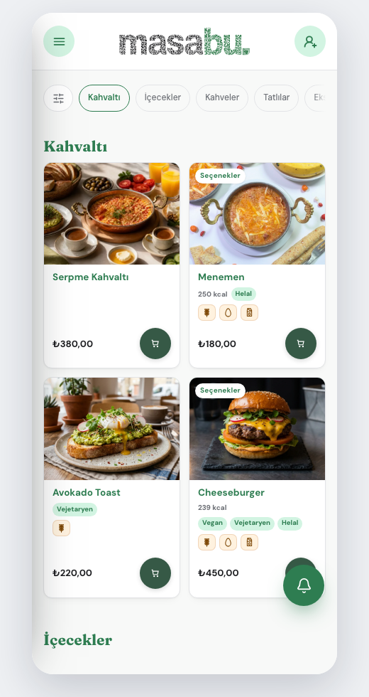
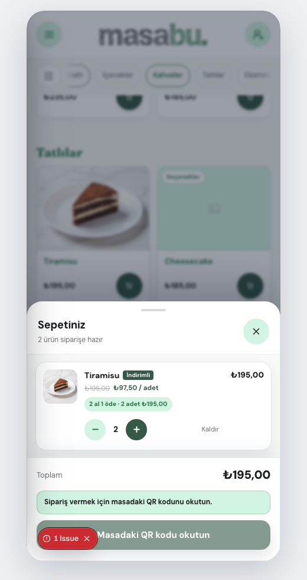

# Kampanya önizleme akışı auditi

Tarih: 2026-08-17

## Kapsam

Tema taslağında seçilen “2 al 1 öde” ürününün Menü önizlemesinden sepete eklenmesi ve kampanya fiyatının sepette açıkça gösterilmesi.

## Kullanıcı hedefi

Tiramisu’yu tek dokunuşla kampanyalı paket olarak eklemek; sepette 2 adet, toplam ₺195 ve kampanya etiketini görmek.

## Adımlar

### 1. Menüden kampanyalı ürünü seçme — Sağlıklı, keşfedilebilirlik geliştirilebilir

- Menü ve ürün kartları kararlı biçimde yükleniyor.
- Tiramisu sepete ekleme kontrolü erişilebilir bir ad taşıyor.
- Ürün kartında kampanya işareti bulunmadığı için kullanıcı kampanyayı sepete eklemeden önce fark edemeyebilir.

### 2. Kampanyalı sepet satırı — Sağlıklı

- Sepet başlığı “2 ürün siparişe hazır” diyor.
- Miktar 2, etkin birim fiyat ₺97,50 ve satır toplamı ₺195,00.
- “2 al 1 öde · 2 adet ₺195,00” etiketi kampanya sonucunu açıkça anlatıyor.
- Artırma ve azaltma kontrolleri ikili paket adımıyla çalışıyor.

## Bulunan kök neden

Kampanya Slider bloğu etkin ve ürün seçimleri doğruydu; ancak `surfaces.home.enabled` kapalı olduğunda Menü kampanya çözümleyicisi Home içindeki etkin kampanya bloğunu yok sayıyordu. Aynı koşul sunucu tarafındaki sipariş fiyat doğrulamasında da vardı.

## Uygulanan düzeltme

- Etkin kampanya blokları, Home açılış sayfasının açık veya kapalı olmasından bağımsız olarak restoran geneli fiyat kuralı kabul ediliyor.
- İstemci önizlemesi ve sunucu sipariş doğrulaması aynı kurala bağlandı.
- Eski tekli sepet satırı bir sonraki tam kampanya paketine yükseltiliyor.
- Sepette kampanya etiketi ve kesin iki ürün fiyatı gösteriliyor.

## Erişilebilirlik ve doğrulama sınırları

- Buton adları ve görünen kampanya bilgisi doğrulandı.
- Tam klavye turu ve ekran okuyucu duyuruları bu iki ekran görüntüsünden tek başına doğrulanamaz.
- Doğrulama izole yerel önizleme akışında yapıldı; tema taslağı yayınlanmadan gerçek masa QR’ı yayınlanmış eski temayı göstermeye devam eder.
