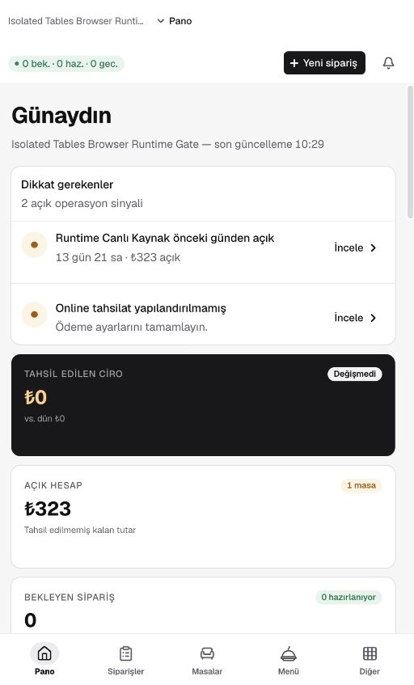
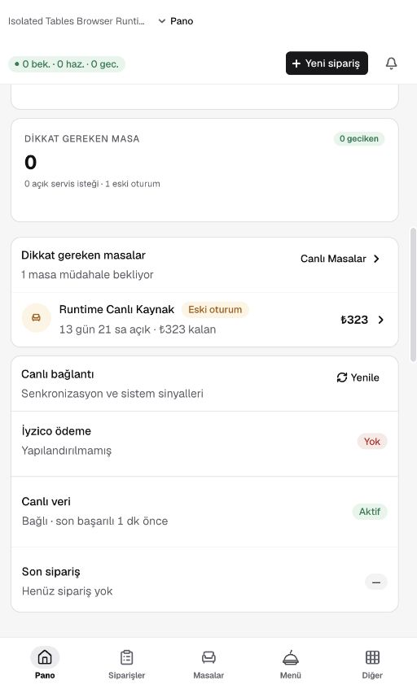
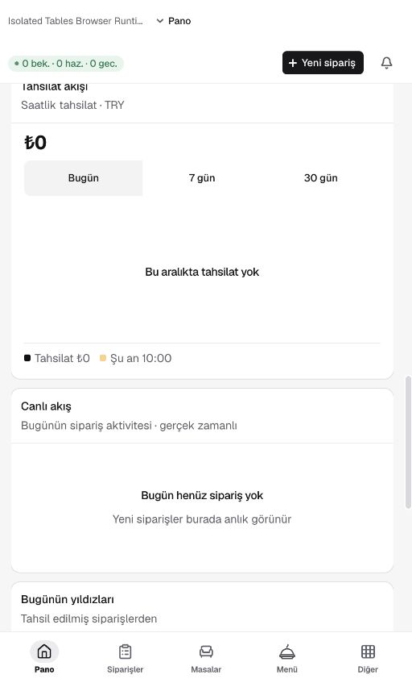
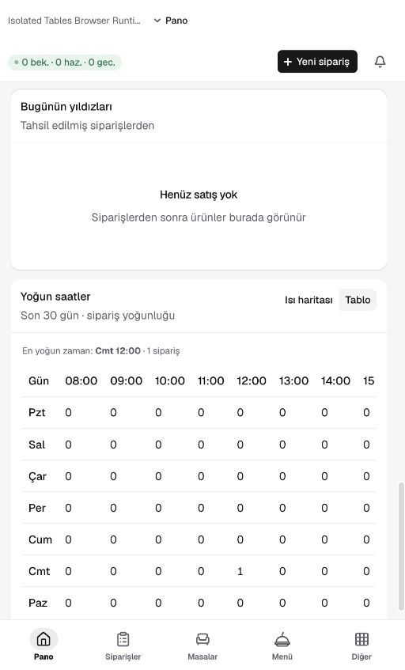
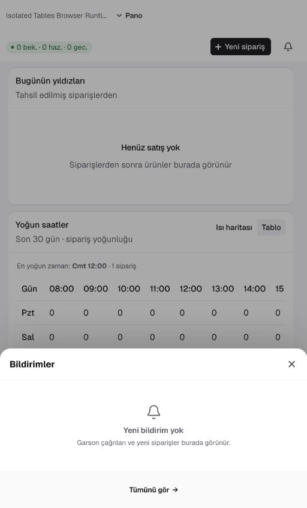
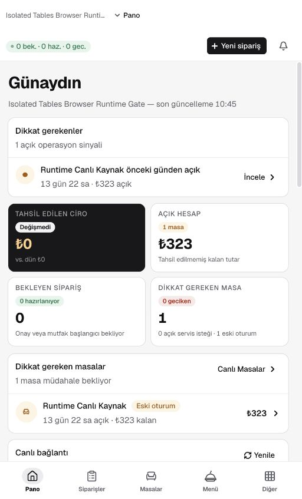
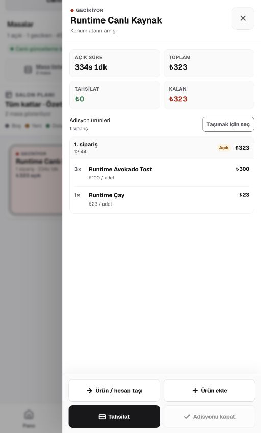
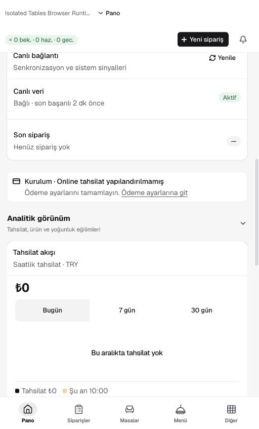

# Pano — canlı arayüz incelemesi

> **Uygulama güncellemesi:** Aşağıdaki dört bulgu aynı gün düzeltildi. İlk incelemenin kanıtları korunmuştur; uygulama ve doğrulama sonuçları belgenin sonundadır.

Tarih: 5 Eylül 2026. Kapsam: pano ana görünümü, operasyon kartları, analitik filtreleri, yoğunluk tablosu ve bildirim paneli. Ürün kodu ve işletme verileri değiştirilmedi.

Kullanıcının açtığı test işletmesi: `Isolated Tables Browser Runtime Gate`, restoran `e0b1faf4-03d6-4171-8044-4fb8ca9dafe6`. Veri durumu: bir eski masa oturumu, ₺323 açık hesap, bugün sıfır sipariş/tahsilat, son 30 günlük yoğunlukta bir sipariş. Bu, yoğun ve gerçek operasyon verisini temsil etmez.

## Sonuç

Pano operasyon odaklı iyi bir temele sahip. Bir doğrulanmış P1 veri sunumu hatası ve üç P2 kullanılabilirlik iyileştirmesi bulundu. Bu sınırlı incelemede P0 görülmedi; lansman onayı değildir.

## İncelenen adımlar

1. **Pano başlangıcı — iyileştirilmeli.** Uyarılar üstte, ciro ve açık hesap birbirinden ayrılmış. Mobil genişlikte kartlar uzun; ödeme kurulumu uyarısı eski masa oturumu ile aynı operasyon önceliğinde.

2. **Operasyon kartları — P1.** “Dikkat gereken masa” 0 iken alt listede “1 masa müdahale bekliyor” yazıyor. ₺323 kalan tutar açık hesap kartı ve masa satırında tutarlı. Canlı veri satırında bağlantı ve son başarı zamanı gösteriliyor; bağlantı kopması denenmedi.

3. **Tahsilat ve boş analitik — işlevsel, yerleşim iyileştirilmeli.** Bugün → 7 gün geçişi yükleniyor metni ve geçici devre dışı kontroller gösterdi; ardından “Son 7 gün · günlük tahsilat” başlığı ve seçimi güncellendi. İnceleme sonunda Bugün seçimine dönüldü. Boş tahsilat ve aktivite panelleri geniş dikey alan kaplıyor.

4. **Yoğun saatler — olumlu.** Isı haritası → Tablo geçişi çalıştı. Tablo cumartesi 12:00 için aynı 1 siparişi gösterdi; erişilebilirlik ağacında tablo ve açıklaması mevcut. Dar görünümde yatay kaydırma ihtiyacı var; ekran okuyucu ile hücre başlığı ilişkileri ve klavye ile yatay kaydırma henüz doğrulanmadı. Sonunda ısı haritasına dönüldü.

5. **Bildirim paneli — incelenen boş durumda olumlu.** Mobil alt panel açılıyor; boş durum sonraki bildirimlerin ne olacağını açıklıyor. Açılış odağı kapatma düğmesinde. Escape paneli kapatıp odağı Bildirimler düğmesine geri verdi. Dolu liste, tümünü gör ve hata durumları bu turda denenmedi.

## Öncelikli bulgular

| Öncelik | Bulgu ve kullanıcı etkisi | Çözüm | Tahmini efor | Doğrulama kriteri |
|---|---|---|---|---|
| P1 | **Dikkat gereken masa sayısı çelişiyor.** Kart 0, liste 1. İşletmeci müdahale gerektiren masayı gözden kaçırabilir. Kanıt: adım 2. | Kart ve liste için ortak, masa kimliği bazında tekilleştirilmiş dikkat kümesi kullan; eski oturumları da dahil et. | Küçük: yarım gün | Yalnız eski oturum olan senaryoda kart ve liste 1; aynı masada gecikme ve servis isteği varsa bir kez sayılmalı. Davranış testi eklenmeli. |
| P2 | **Dar görünümde özet fazla uzun.** Uyarı, dört büyük KPI, sağlık kartı ve varsayılan açık boş analitik paneller operasyonu taramayı yavaşlatıyor. Kanıt: adım 1–3. | Kritik masa/sipariş özetini kompaktlaştır; boş analitik kartlarının yüksekliğini azalt. 390 px için iki sütun ancak metin ve dokunma alanları korunuyorsa; 320 px için ayrıca doğrula. | Orta: 1–2 gün | 320/390 px ve %200 yakınlaştırmada taşma olmadan uyarı ve operasyon özeti daha az kaydırmayla okunmalı; tüm bilgiye erişim korunmalı. |
| P2 | **“İncele” masa bağlamını taşımıyor.** Üst eski oturum uyarısının URL'si genel `/tables`; alt masa satırının URL'si doğru `?tableId=…` içeriyor. Kullanıcı üst aksiyondan sonra masayı yeniden bulmak zorunda kalabilir. Kanıt: adım 1–2 ve canlı erişilebilirlik ağacındaki bağlantılar. Hedef ekran bu turda açılmadı. | Üst uyarıda da aynı masa bağlantısını kullan. | Küçük: birkaç saat | Üst uyarıdan ilgili masa detayı doğrudan açılmalı; artık mevcut olmayan masa için anlaşılır geri dönüş olmalı. |
| P2 | **Kurulum eksiği operasyon uyarısıyla aynı ağırlıkta.** Online tahsilat yapılandırması “2 açık operasyon sinyali” sayısına dahil; ayrıca Canlı bağlantı kartında tekrar ediliyor. Acil masa müdahalesiyle kalıcı kurulum işi yarışıyor. Kanıt: adım 1–2. | Kurulum/ödeme hazırlığını ayrı, kompakt bir alanda göster; aktif servis uyarısı sayısını ayrı tut. Online tahsilatın işletme için zorunlu olup olmadığı ürün kararıyla belirlenmeli. | Orta: 1 gün | Sadece ödeme kurulumu eksik olan işletmede acil masa sayısı artmamalı; ayarlara geçiş görünür kalmalı. |

P1'in kaynak nedeni: `apps/dashboard/components/pano/pano-view-model.ts:85` yalnız geciken masa ve servis isteği kimliklerini sayıyor. `apps/dashboard/components/pano/PanoAttentionTables.tsx:43` ise `stale` durumunu da listeye dahil ediyor. Aynı kavram için iki farklı filtre var.

## Korunması gerekenler

- Tahsil edilen ciro ile henüz tahsil edilmemiş açık hesabın ayrılması.
- Uyarılardan aksiyona geçiş ve masa satırında kalan tutarın gösterilmesi.
- Son başarılı senkronizasyon bilgisinin görünür olması.
- Analitik tarih değişiminde yükleniyor geri bildirimi.
- Isı haritası için tablo alternatifi ve bildirim panelinin gözlenen odak geri dönüşü.

## Kanıt sınırları ve devam sırası

Kabul edilen ekranlar mevcut dar Browser görünümünden alındı ve kaydedilen dosyalar tekrar açıldı. Kararlı doğal görünümde 512 CSS px genişlik ve 846 CSS px yükseklik ölçüldü. İstenen 1440 ve 390 boyutları ile gerçek `innerWidth` uyuşmadı; emülasyon ekranlarında ölçek/canvas sorunu görüldü. Bu nedenle emülasyon çıktıları görsel uygunluk kanıtı değildir; 320/390/768/1440 matrisi tamamlanmış sayılmadı. Viewport override kaldırıldı.

İlk MAF işletmesinde Pano bağlantısı Plus erişim ekranına yönlendi. “Pano” → “Raporlar” adlandırma farkı gözlendi, ancak o ekran kullanıcı geçişi sırasında kaydedilemedi; kabul edilen görsel bulgulara dahil edilmedi.

%200 yakınlaştırma, azaltılmış hareket, tam klavye dolaşımı, ekran okuyucu, bağlantı kopması, yavaş/başarısız istek, dolu sipariş/bildirim listeleri, masa detayı ve yeni sipariş akışı henüz test edilmedi. Bu turda performans ölçümü, lint, build veya test paketi çalıştırılmadı; önceki raporun sonuçları yeni ölçüm gibi kullanılmadı.

Uygulama sırası: ortak dikkat kümesi ve davranış testi → masa bağlamını koruyan uyarı bağlantısı → kurulum/operasyon ayrımı → mobil yoğunluk düzenlemesi → gerçek viewport matrisi ve hata/dolu veri senaryoları.

## Uygulama ve doğrulama — 5 Eylül 2026

- **P1 düzeltildi:** KPI ve liste `selectPanoAttentionTables` üzerinden aynı masaları kullanıyor. Eski oturumlar dahil; çakışan servis/gecikme sinyalleri ve yinelenen masa kimlikleri tekilleştiriliyor. Listede olmayan masaya ait istek, listelenebilir masa sayısını artırmıyor; servis uyarısı kendi kuyruğunda kalıyor.
- **Masa bağlantısı düzeltildi:** Geciken masa, eski oturum ve servis isteği uyarıları URL'ye kodlanmış `tableId` ekliyor. Browser'da üst “İncele” aksiyonu kullanıldı; Runtime Canlı Kaynak masası ve ₺323 adisyon doğrudan açıldı. Adisyonda işlem yapılmadı.
- **Kurulum ayrıldı:** Ödeme kurulumu operasyon sayısından çıkarıldı, işletme sahibine ayrı bir kurulum notu ve ayarlara bağlantı gösteriliyor. Eksik yapılandırma canlı bağlantı listesinde tekrar hata olarak gösterilmiyor. Yapılandırılmış canlı/test ödeme durumları korunuyor.
- **Mobil yoğunluk azaltıldı:** 380–760 px arasında KPI'lar iki sütun; daha dar ekranlarda tek sütun. Kartlar içerik kadar büyüyor, uzun metinler sarılıyor. Mobil boş paneller 160 px yerine 96 px asgari yükseklik kullanıyor. Analitik aç/kapat davranışı korunuyor.

### Kontroller

| Kontrol | Sonuç |
|---|---|
| Pano hedefli testler | 44 geçti; beş yeni davranış testi dahil |
| Dashboard test paketi | 862 geçti, 0 başarısız / atlanan |
| TypeScript | Başarılı |
| Değişen sekiz kaynak/test dosyasında ESLint | Başarılı |
| Dashboard production build | Başarılı, Next.js 15.5.25 |
| Dashboard rota JS bütçeleri | Başarılı |
| Gerçek test işletmesinde Browser | Sayaç 1 / liste 1; operasyon sinyali 1; ilgili masaya doğrudan geçiş başarılı |

Test, lint, typecheck, build ve bundle çıktıları `evidence/pano/fixed-*.log` dosyalarındadır. Yeni bağımlılık, veritabanı değişikliği veya framework yükseltmesi yapılmadı. Yerel production sunucusu 3005 portunda yeniden başlatıldı.

### Responsive ölçümler

Browser viewport aracının ölçek farkı, ayar değerleri yerine gerçek `innerWidth` ölçülerek telafi edildi. Aşağıdakiler DOM/geometri kontrolleridir; emülasyonun ekran yakalama sorunu nedeniyle tam görsel matris onayı değildir.

| Ölçülen CSS genişliği | KPI sütunları | Belge genişliği | Kontrol edilen kart/bağlantı/düğmelerde yatay taşma |
|---|---|---|---|
| 320 | 1 | 320 | Yok |
| 390 | 2 | 390 | Yok |
| 768 | 2 | 768 | Yok |
| 1440 | 4 | 1440 | Yok |

Ham ölçümler: [fixed-responsive-dom.json](evidence/pano/fixed-responsive-dom.json). 512 px doğal görünümde mobil kartlar yaklaşık 116 px, boş paneller 96 px ölçüldü. %200 yakınlaştırma, azaltılmış hareket, tam klavye/ekran okuyucu, dolu bildirim ve ağ hata senaryoları bu uygulama turunun doğrulama kapsamına dahil değildir.

### Yeni ekran kanıtları

Uygulamada kullanılan mevcut bileşen API'leri [Next.js 15 Link](https://nextjs.org/docs/15/app/api-reference/components/link), [shadcn Alert](https://ui.shadcn.com/docs/components/base/alert), [Card](https://ui.shadcn.com/docs/components/base/card) ve [Empty](https://ui.shadcn.com/docs/components/base/empty) belgeleriyle kontrol edildi.
