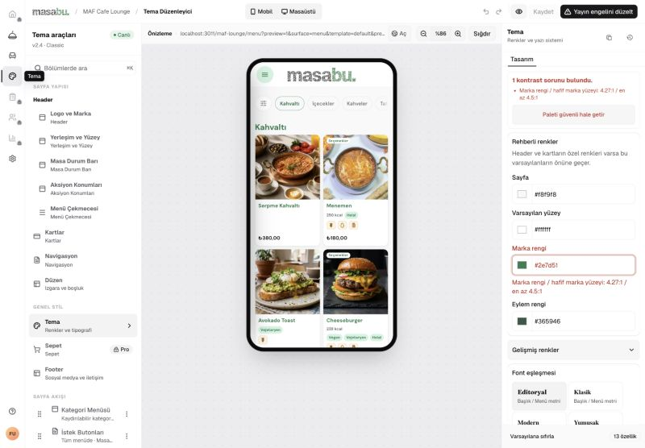
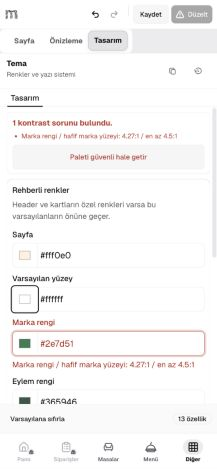
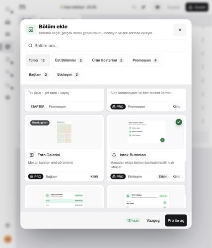

# Tema bölümü auditi — 5 Eylül 2026

Tema editörünün ana yapısı korunabilir. Üç sütunlu masaüstü çalışma alanı, mobil Sayfa / Önizleme / Tasarım ayrımı, gerçek menü bileşenlerinden oluşturulan katalog ve kontrast rehberliği iyi temeller. Öncelikli sorunlar **önizleme doğruluğu, taslak çakışmasından kurtarma ve istemci/sunucu yayın kontrollerinin tutarlılığı**. Bu incelemede P0 doğrulanmadı; **3 P1 ve 3 P2** bulgu var.

Bu turda ürün kodu, şema, taslak veya canlı tema değiştirilmedi. Tarayıcıda tek bir renk denemesi yapıldı ve Geri al ile başlangıca dönüldü; Kaydet yeniden devre dışı kaldı. Kaydet, yayınla, yükle ve sil işlemleri gönderilmedi. Önceki LCP değişiklikleri çalışma ağacında bırakıldı.

## Kapsam ve yöntem

- Giriş yapılmış uygulama içi tarayıcı; yerel dashboard `localhost:3005`, menü `localhost:3011`.
- Boş katalog: Isolated Tables Browser Runtime Gate. Dolu katalog ve plan kısıtları: MAF Cafe Lounge (`maf-lounge`).
- Gerçek `window.innerWidth` ile doğrulanan **320, 390, 768 ve 1440 CSS px** genişlikleri. İncelenen sayfa yüzeylerinde belge yatay taşması gözlenmedi. Ekran görüntüleri bu audit sırasında alındı; görüntü yakalama aracının boş tuval eklediği yerlerde yalnız tarayıcı yüzeyi capture aracının `clip` seçeneğiyle alındı.
- Sekme geçişleri, bölüm seçimi, katalog dialogu, renk değişikliği, iframe güncellemesi, bağımsız önizleme, geri alma ve dialog sonrası odak dönüşü gözlendi.
- Teknik inceleme: tema giriş rotası, veri okuma, taslak/yayın işlemleri, revizyonlar, önizleme köprüsü, plan yansıtması, medya doğrulaması ve mevcut testler.
- Yerel menünün production sürecinde dashboard iframe origin'i tanımlı değildi. Audit sürecine yalnız `http://localhost:3005` geçici olarak tanımlandı. Dosyalarda veya production ortamında ayar değiştirilmedi. Başlangıçtaki iframe engeli ürünün genel arızası olarak sayılmadı; hata açıklaması ve Yeniden dene ile toparlanma gözlendi.

## İncelenen adımlar

| Adım | Akış | Genel durum | Bu turdaki kanıt |
|---|---|---|---|
| 1 | Boş menüyle editöre giriş | Kullanılabilir; ürün ekleme yönlendirmesi zayıf | [Boş editör](evidence/theme-audit/01-desktop-editor.jpg) |
| 2 | Bölüm kataloğunu açma | Arama, gruplama ve gerçek bileşen önizlemeleri güçlü | [Katalog](evidence/theme-audit/02-section-catalog.jpg) |
| 3 | Dolu menüde tema ayarları | Düzen anlaşılır; mevcut palette yayın engeli bulunuyor | [1440 px editör](evidence/theme-audit/03-populated-desktop-capture.jpg) |
| 4 | Mobil önizleme ve tasarım | Bölmeler çalışıyor; kayıt durumu kayboluyor | [390 px önizleme](evidence/theme-audit/04-mobile-preview.jpg), [kaydedilmemiş değişiklik](evidence/theme-audit/05-mobile-unsaved.jpg) |
| 5 | Değişikliği iframe ve yeni sekmede görme | Tutarsız; bağımsız önizleme eski temayı gösteriyor | [Iframe](evidence/theme-audit/06-unsaved-iframe.jpg), [yeni sekme](evidence/theme-audit/07-detached-preview.jpg) |
| 6 | Dar ekranda sayfa akışı ve plan dışındaki bölüm | Akış kullanılabilir; mevcut bölümün plan durumu belirsiz | [320 px akış](evidence/theme-audit/08-mobile-320-flow.jpg), [özellik paneli](evidence/theme-audit/09-existing-locked-section.jpg), [768 px katalog](evidence/theme-audit/10-tablet-locked-catalog.jpg) |
| 7 | Kaydet/yayınla hata ve doğrulama yolu | Kaynak incelemesinde iki P1; canlı mutasyon denenmedi | F2, F3 ve [test kaydı](evidence/theme-audit/theme-tests.log) |

## Bulgular

Masaüstü başlangıç durumu (adım 3):

Mobilde kaydedilmemiş renk değişikliği (adım 4):

Plan dışındaki mevcut bölümün katalogdaki durumu (adım 6):

### F1 — P1: “Önizle / Aç” editördeki tasarımı temsil etmiyor

**Kanıt:** Sayfa rengi `#f8f9f8` → `#fff0e0` olarak yalnız yerel editörde değiştirildi. Iframe DOM'unda arka plan `rgb(255, 240, 224)` oldu; Aç ile açılan sekmede `rgb(248, 249, 248)` kaldı. Görsel kanıt adım 5'te. Yeni sekme farklı genişlikte açıldığından kart düzenleri değil, DOM'daki renk değerleri karşılaştırıldı.

**Kök neden:** [use-theme-editor-workspace.ts:44](../../../apps/dashboard/components/theme/use-theme-editor-workspace.ts#L44) yalnız `window.open(previewUrl)` çalıştırıyor; [ThemeEditorCanvas.tsx:106](../../../apps/dashboard/components/theme/ThemeEditorCanvas.tsx#L106) aynı URL'yi bağlantı olarak açıyor. [published-theme.ts:44](../../../apps/menu/lib/published-theme.ts#L44) içindeki `getPreviewTheme` ise `readPublishedTheme` çağırıyor. Yerel tema yalnız iframe'e mesajla gönderiliyor. Kaydedilmiş ama yayınlanmamış taslağın da bağımsız sekmeye taşınmaması kaynak kodundan çıkarımdır; bu audit taslak kaydetmedi.

**Etki:** İşletmeci önizlemede değişikliklerin kaybolduğunu veya kaydın çalışmadığını düşünebilir; yanlış görünümü onaylayabilir.

**Çözüm:** Bağımsız önizlemeyi belirli bir taslak/yerel snapshot ile eşleştir. Alternatif olarak mevcut bağlantıyı açıkça “Yayındaki menüyü aç” olarak adlandır ve gerçek taslak önizlemesini ayrı sun. URL'ye tüm tema belgesini koyma.

**Efor:** 1–2 gün. **Kabul:** Kaydedilmemiş, kaydedilmiş taslak ve yayındaki tema farklı renklerle test edilir; her önizleme hangi sürümü gösterdiğini belirtir ve doğru snapshot'ı render eder. Tenant ve token kontrolleri korunur.

### F2 — P1: Çakışma mesajı yenileme öneriyor; yerel çalışmayı kurtarma akışı yok

**Kanıt türü:** Kaynak incelemesi; iki çalışanla canlı çakışma oluşturulmadı. [use-theme-editor-lifecycle.ts:376](../../../apps/dashboard/components/theme/use-theme-editor-lifecycle.ts#L376) çakışmada yalnız toast gösterip dönüyor: “Yerel değişikliklerin korundu; sayfayı yenileyip birleştir.” Yerel overrides ve undo/redo bellekte tutuluyor; bu akışta kalıcı kurtarma kaydı, dışa aktarma veya gelen snapshot ile birleştirme yok. Revizyon referansı da çakışma dalında güncellenmiyor. Beforeunload uyarısı var, fakat onaylanan yenileme yerel belleği korumaz.

**Etki:** İki çalışan aynı temayı düzenlediğinde ikinci kişinin emeğini kaybetme riski; yeniden Kaydet aynı çakışmayı tekrarlar. Kullanıcıya verilen talimat uygulanabilir bir birleştirme akışı sunmuyor.

**Çözüm:** Kalıcı çakışma panelinde sunucu sürümünü ve yerel değişiklikleri göster; yerel taslağı güvenle sakla veya dışa aktar. Kullanıcı seçiminden sonra güncel revizyonla yeniden kayıt yap. Sessiz üzerine yazma uygulama.

**Efor:** 2–3 gün. **Kabul:** İki oturum aynı revizyondan düzenler; ikinci kayıt çakışınca yerel değişiklikler yenileme sonrasında kurtarılır, karşılaştırılabilir ve seçilen içerik doğru revizyonla kaydedilir.

### F3 — P1: Header kontrastı istemcide engelleniyor, sunucudaki yayın doğrulamasında eksik

**Kanıt türü:** Kaynak + saf fonksiyon deneyi; canlı yayın isteği gönderilmedi. [use-theme-editor-lifecycle.ts](../../../apps/dashboard/components/theme/use-theme-editor-lifecycle.ts) `inspectMenuHeaderContrast` sonucuna göre yayını engelliyor. [actions/theme.ts:315](../../../apps/dashboard/lib/actions/theme.ts#L315) içindeki sunucu yayın yolu diğer kontrast denetimlerini yapıyor, Header denetimini çağırmıyor.

Sanitize edilmiş varsayılan temaya yalnız `surfaces.menu.chrome.header` altında beyaz zemin ve `#eeeeee` metin/ikon verildi. Header denetimi **1,16:1 metin**, **1,16:1 ikon**, **1,02:1 kontrol ikonu** hataları buldu; sunucu yolunun kullandığı diğer yedi kontrast denetimi boş sonuç verdi. Bu nedenle eksik denetimi diğer kontroller telafi etmiyor.

**Etki:** Farklı/eski bir istemci veya doğrudan yetkili action çağrısı, normal editörün kabul etmediği okunaksız bir Header'ı yayın yoluna sokabilir. Bu bulgu bir tenant yetki aşımı iddiası değildir.

**Çözüm:** Yayın uygunluğunu ortak bir saf doğrulayıcıda topla; istemci bunu rehberlik için, sunucu zorunlu kontrol için kullansın. Header dahil aynı hata kodlarını döndür.

**Efor:** 0,5–1 gün. **Kabul:** Yukarıdaki belgeyi kullanan sunucu action testi yayını reddeder ve persistence çağrısı yapılmaz; normal tema kabul edilir. İstemci ve sunucu aynı ihlal listesini üretir.

### F4 — P2: Mobilde kayıt durumu ve işletme bağlamı gizleniyor

**Kanıt:** Adım 4'te renk değiştirildiğinde Kaydet etkinleşiyor ancak “kaydedilmedi”, değişiklik sayısı veya hangi restoranın düzenlendiği görünmüyor. [ThemeEditorShell.tsx:179](../../../apps/dashboard/components/theme/ThemeEditorShell.tsx#L179) 901–1450 px aralığında kayıt durumunu; aynı dosyanın mobil kuralları 649 px altında durum rozetini, başlık/işletme metnini ve başlıklı değişiklik rozetini gizliyor. 1440 px de durumun gizlendiği aralıkta.

**Etki:** Kaydetmenin canlı menüyü değiştirip değiştirmediği, yayın bekleyen taslak bulunup bulunmadığı ve hangi mağazanın düzenlendiği özellikle telefonda belirsizleşiyor. “Düzelt” kısaltması, önizleme sekmesinde tek başına yeterli açıklama sunmuyor.

**Çözüm:** Tek satırlık kalıcı durum alanı kullan: “MAF · Kaydedilmemiş değişiklik”, “Taslak kaydedildi · Yayın bekliyor”, “Yayında”. Yayın engelinin ne olduğu dokunmayla erişilebilsin; açıklamalar yalnız `title` hover metnine dayanmasın.

**Efor:** 0,5–1 gün. **Kabul:** 320/390/768/1440 px'de temiz, kirli, kaydediliyor, kayıt hatası ve yayın bekliyor durumları hem görünür hem erişilebilir isimlerle ayırt edilir.

### F5 — P2: Mevcut plan dışı bölüm, düzenleme panelinde normal bölüm gibi görünüyor

**Kanıt:** MAF'ın mevcut “İstek Butonları” bölümü sayfa ağacında ve özellik panelinde normal düzenlenebilir bölüm olarak göründü; panelde önizlemede neden görünmediğini açıklayan plan uyarısı yoktu. Aynı bölüm katalogda **Etkin + Kilitli**, alt eylemde **Pro ile aç** olarak gösterildi (adım 6). [ThemeEditorSidebar.tsx](../../../apps/dashboard/components/theme/ThemeEditorSidebar.tsx) genel araç gruplarında `locked` işlerken sayfa akışı bölüm satırına eşdeğer durum taşımıyor. Önizleme köprüsü entitlement yansıtmasını uygulamayı sürdürüyor.

**Etki:** Kullanıcı görünmeyen bir bölümü düzenlemek için zaman harcar. “Etkin” etiketi müşterilerin gördüğü bir bölüm izlenimi verir. Yapılandırmayı korumak doğru; görünürlük durumunu açıklamak eksik.

**Çözüm:** Akış satırı ve özellik paneline “Yapılandırma korunuyor · Mevcut planda gösterilmiyor” açıklaması ekle. Katalogdaki “Etkin” için “Temaya ekli” gibi yayın görünürlüğünden farklı bir ifade kullan.

**Efor:** 0,5–1 gün. **Kabul:** Planı düşmüş, önceden eklenmiş Pro bölümü bulunan temada ağaç, panel, katalog ve önizleme aynı durumu anlatır; ayarlar silinmez.

### F6 — P2: Menü referansları okunamazsa hata, boş menüye dönüştürülüyor

**Kanıt türü:** Kaynak incelemesi; ağ arızası enjekte edilmedi. [queries/theme-editor.ts:14](../../../apps/dashboard/lib/queries/theme-editor.ts#L14) başarısız Result için `{ categories: [], items: [] }` döndürüyor. Editör rotası bu sonucu başarıyla okunmuş boş katalogdan ayıramıyor. Başlangıçtaki gerçekten boş restoran, bu boş görünümün kullanıcıya nasıl sunulduğunu gösterdi; veritabanı arızası gözlemi olarak kullanılmadı.

**Etki:** Geçici sorgu/yetki bağlamı sorunu “ürünler yok” gibi görünür; ürün seçimi ve önizleme güvenilmez hale gelir. Bu audit veri kaybı doğrulamadı.

**Çözüm:** Başarı/boş/hata durumlarını ayrı döndür. Hata halinde menü referanslarına bağımlı düzenlemeyi engelle, okunabilir uyarı ve Yeniden dene sun; tema taslağını koru.

**Efor:** 0,5–1 gün. **Kabul:** Başarılı boş katalog, dolu katalog ve başarısız sorgu üç ayrı davranış testiyle doğrulanır; hata ekranı yanlışlıkla boş başarı durumuna geçmez.

## Korunması gerekenler

- Taslak kaydı ve canlı yayın ayrı işlemler; revizyon ve requestId sözleşmeleri mevcut. Atomic persistence yolu korunmalı.
- Sunucu action'larında tema erişimi denetleniyor; preview tokenı ve iframe mesajlarında origin/source doğrulaması var. Bu audit bunların tam penetrasyon testi değildir.
- Kaydetme hatalarında yerel state hemen sıfırlanmıyor; undo renk denemesinde temiz duruma doğru döndü.
- Kontrast rehberliği gerçek sorun gösteriyor: MAF'ın mevcut paletinde `4,27:1 / 4,5:1` uyarısı ve düzeltmeye yönlendiren eylem var. Bu mevcut tema verisine ait bulgudur; bütün temaların bozuk olduğu anlamına gelmez.
- Katalog dialogu kapanınca odak Bölüm ekle düğmesine döndü. Form alanlarında isimler ve mobil bölmelerde tab semantiği mevcut.
- Önizleme başarısızlığında açıklama ve yeniden deneme var. Hareket azaltma için CSS kuralı mevcut; cihaz ayarıyla çalışma zamanı doğrulaması yapılmadı.

## Teknik karar ve test durumu

**Koru:** Next.js 15.5.25 / React / Supabase ve mevcut ortak UI bileşenleri. Bulgular mevcut stack içinde çözülebiliyor; bu audit framework yükseltmesi veya yeni servis gerektiren kanıt üretmedi.

**Sadeleştir:** Kontrast/publish doğrulamasını birleştir; hata ve taslak durumlarını ortak, açık bir durum modeliyle yönet. `ThemeSectionSettings.tsx` 1090, `ThemeExperiencePanels.tsx` 1473 satır; bunları bölme önceliği satır sayısından çok test edilebilir sorumluluk sınırları olmalı. Next.js 15 rehberi de beklenen hataların istemciye açık sonuçlar olarak taşınmasını ve Server Functions içinde yetkilendirme yapılmasını öneriyor: [hata yönetimi](https://nextjs.org/docs/15/app/getting-started/error-handling), [veri güncelleme](https://nextjs.org/docs/15/app/getting-started/updating-data).

**Değiştir:** Önizleme bağlantısının sözleşmesi ve çakışma kurtarma deneyimi. Tema görünümünü yeniden tasarlamak öncelik değil.

`apps/dashboard` altında `node --import tsx --test components/theme/*.test.ts` bu turda çalıştırıldı: **271 geçti, 0 başarısız**. 47 tema test dosyasının 24'ünde kaynak dosya okuma var; bu dosyaların tamamının yalnız metin testi olduğu iddia edilmiyor, fakat geçen sayı gerçek kullanıcı akışının tamamının doğrulandığı anlamına gelmiyor. F1–F6 için davranış/integrasyon testleri eklenmeli. Ürün kodu değişmediğinden full workspace build/lint tekrar çalıştırılmadı; önceki turun sonuçları bu auditin yeni kanıtı sayılmadı.

Tarayıcı deneyinin kısa, tokensız kaydı: [observations.json](evidence/theme-audit/observations.json).

## Sınırlar

- Kaydet/yayınla mutasyonları, gerçek iki oturum çakışması, başarısız upload, ağ kesintisi, token süresi dolması ve yetkisiz hesap bu turda uçtan uca denenmedi.
- Mevcut yerel production dashboard'da V2 deneyim seçicisi görünmüyor; Ana sayfa / giriş / hesap / checkout yüzeyleri UI auditinde tamamlanmış sayılmadı. İlgili özellik bayrağı kaynakta incelendi; açılmadı.
- Klavye kontrolü alan geçişi ve dialog odağıyla sınırlı. Tam ekran okuyucu, yüzde 200 yakınlaştırma ve çalışma zamanında azaltılmış hareket denemesi yok; WCAG uyumu iddia edilmiyor.
- Rota JS boyutu, CPU profili, yayın gecikmesi veya Lighthouse tema performansı ölçülmedi. Bileşen büyüklüğünden performans arızası sonucu çıkarılmadı.

## Düzeltme sırası

1. F3: Ortak sunucu/istemci yayın doğrulayıcısı ve action testi.
2. F2: Kalıcı çakışma durumu, yerel kurtarma ve iki oturum testi.
3. F1: Sürümü belirli önizleme sözleşmesi; iframe ve yeni sekme testi.
4. F6: Menü referansı hatasını boş durumdan ayırma.
5. F4: Bu durum modelini mobil/masaüstü durum çubuğuna taşıma.
6. F5: Mevcut plan dışı bölümlerin açıklamalarını tutarlı hale getirme.

Eforlar tek geliştirici için kaba tahmindir; sıradaki çalışma henüz başlatılmadı.
