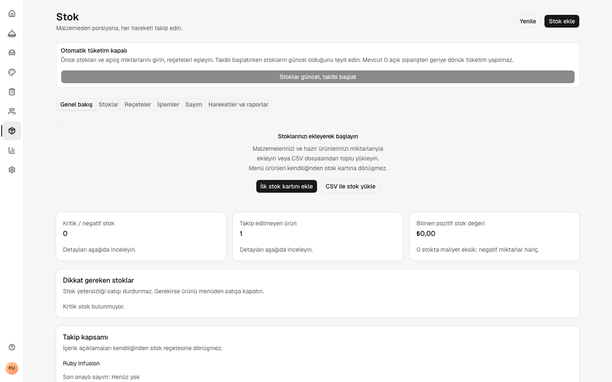
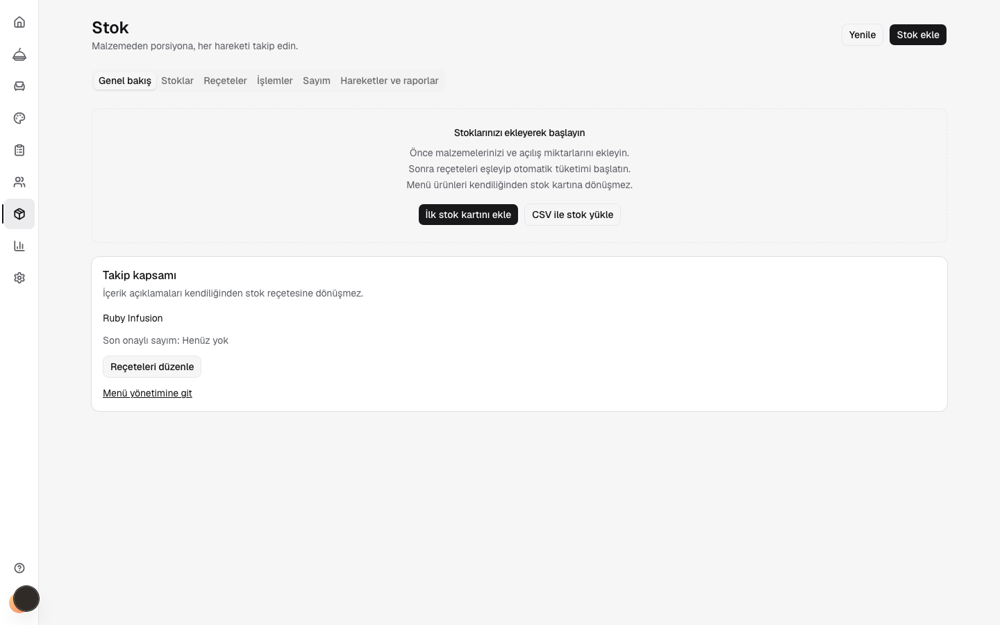
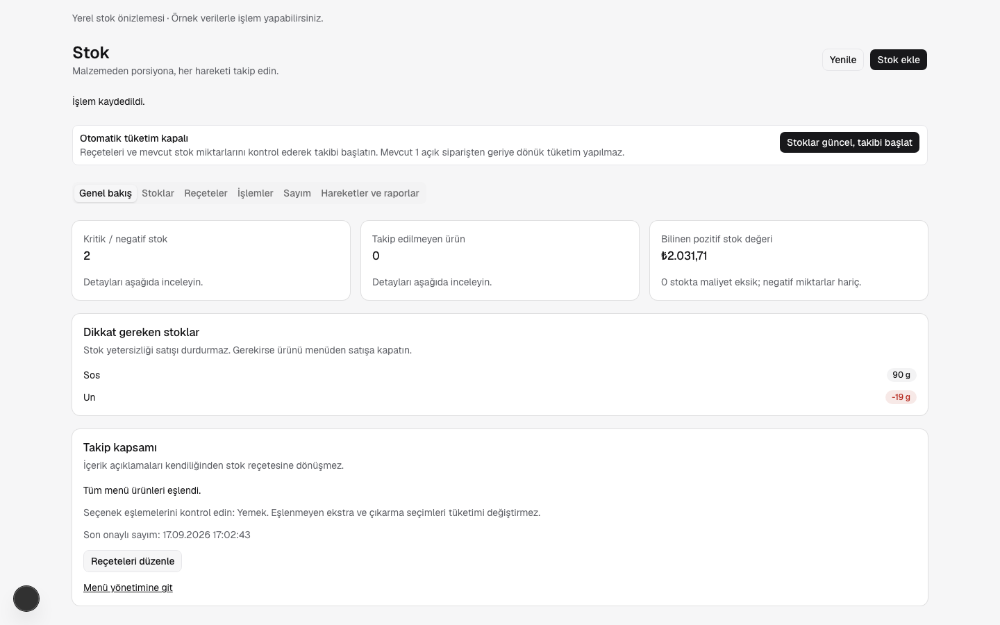
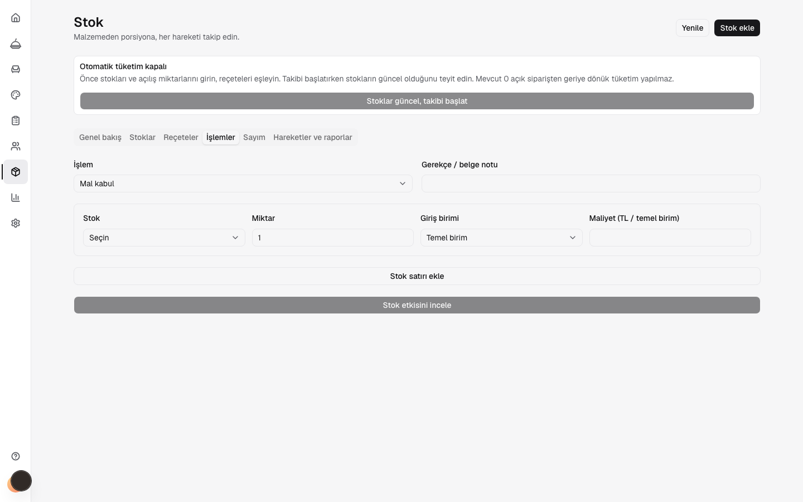
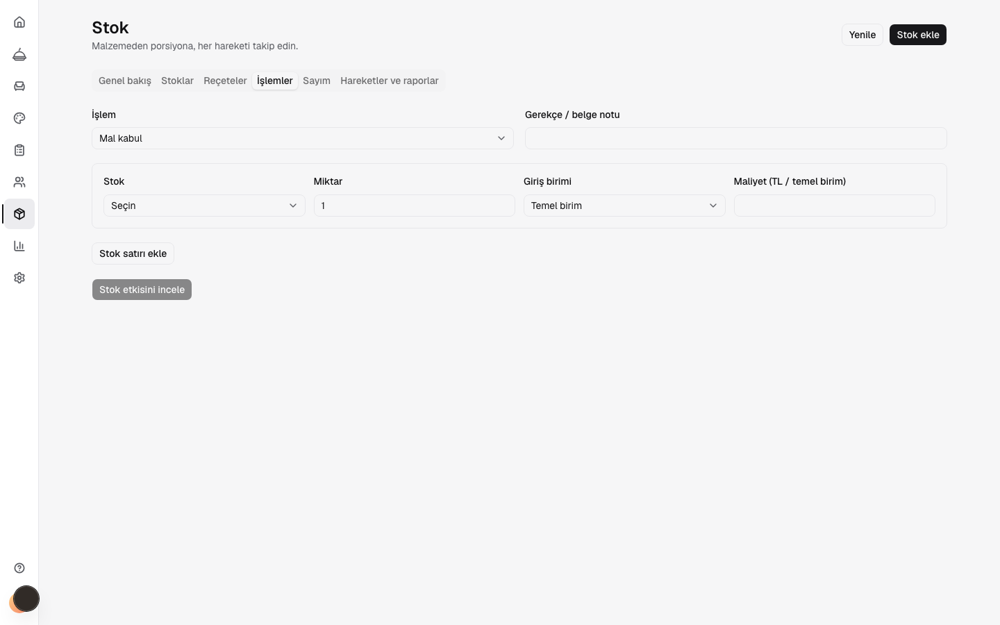
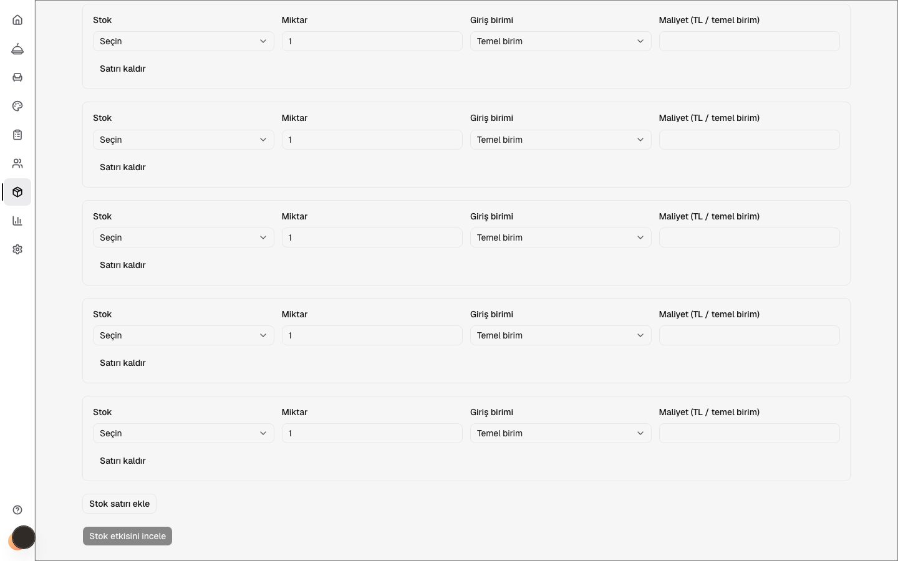
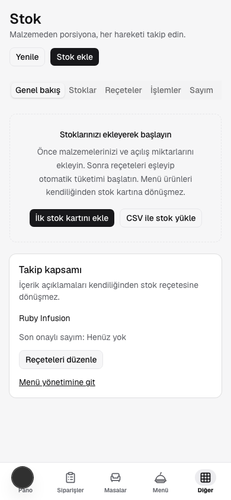
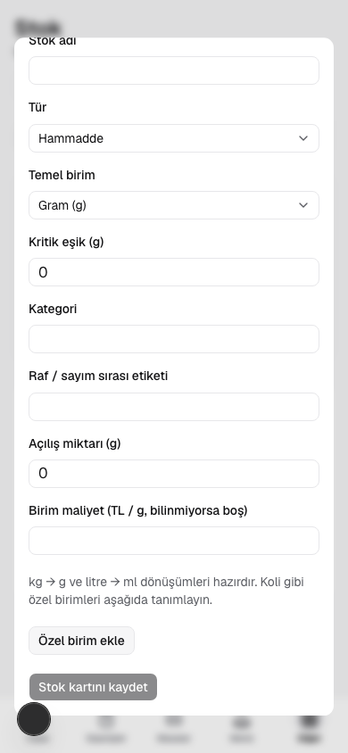

# Stok ekranı — UI/UX incelemesi ve düzeltme

17 Eylül 2026. Product Design audit akışıyla localhost üzerindeki oturum açılmış dashboard incelendi. Kapsam: boş başlangıç, işlem formu ve mobil stok kartı penceresi. 1440×900 ve 390×844 ekranlarda Playwright kullanıldı. İşletmeye stok yazılmadı; uzun form için yalnız kaydedilmemiş satırlar eklendi.

## 1. Genel bakış ve sayfa kaydırma — düzeltildi

**Önce:** 1014 px içerik, 900 px yüksekliğinde `overflow: hidden` olan dashboard alanına sığıyordu; fareyle kaydırma sonrasında sayfa ve belge kaydırma değerleri sıfır kaldı. Alt içerik erişilemezdi. Boş stok durumunda kullanılamayan takip başlatma butonu ve sıfır değerli kartlar ilk stok girişinin önüne geçiyordu.

**Sonra:** Stok çalışma alanı kendi dikey kaydırmasını yönetiyor. İç içe iki `main` yerine tek ana alan ve adlandırılmış, klavyeyle odaklanabilen stok bölgesi var. Boş başlangıçta manuel giriş ve CSV yükleme öne çıkıyor; miktar kartları stok oluşturulunca gösteriliyor. Takip başlatma uyarısı da stoklar eklendikten sonra görünüyor, buton içeriği kadar yer kaplıyor.

İzole localhost:3024 PostgreSQL fixture'ında stok varken takip başlatma butonu da kontrol edildi: masaüstünde genişliği 320 px altında. Bu kontrol yalnız sentetik test işletmesinin takibini duraklattı.

Güçlü taraf: stok kartı ve menü ürünü ayrımı açıklanıyor; iki giriş yolu görünür. Erişilebilirlik kontrolü: tek ana alan ve klavye kaydırması doğrulandı. Ekran okuyucu anonsları ayrıca test edilmedi.

## 2. İşlem formu ve alt aksiyonlar — düzeltildi

**Önce:** Satır ekleme ve önizleme butonları formun tüm genişliğine yayılıyordu. Kısa etiketli aksiyonlar gereksiz görsel ağırlık taşıyordu.

**Sonra:** İşlem, reçete, sayım ve stok kartı aksiyonları doğal genişlikte. Giriş alanları form düzenini koruyor. Uzun işlem formunda fare ve Home/End ile 701 px kaydırma ve alttaki aksiyonlara erişim doğrulandı.

Güçlü taraf: alan etiketleri görünür, stok etkisini inceleme adımı korunuyor. Sınır: bu düzeltmede gerçek işletmede işlem kesinleştirilmedi; stok hesaplama doğrulaması ana uygulama testlerinde kayıtlı.

## 3. Mobil başlangıç ve stok kartı — kontrol geçti

390 px genişlikte sayfa yatay taşmıyor. Uzun işlem sayfası kaydırılabiliyor. Stok kartı penceresinde kaydet düğmesi kaydırarak görünür alana getirilebiliyor; Escape pencereyi kapatıyor. Boş başlangıç artık ilk ekrana sığıyor.

Güçlü taraf: etiketli alanlar ve mevcut Base UI pencere davranışı korunuyor. Sınır: fiziksel cihaz, dokunmatik hareketler, sanal klavye ve tam ekran okuyucu/kontrast denetimi yapılmadı; tam erişilebilirlik uyumluluğu iddiası yok.

## Doğrulama

- Dashboard tip kontrolü ve değişen beş stok bileşeninin lint kontrolü geçti.
- [Önceki kaydırma ölçümleri](ux/before.json), [sonraki Playwright sonuçları](ux/after.json).
- Tekrar kontrol: `node scripts/inventory/ux-check.mjs` (localhost:3000, mevcut yerel dashboard test oturumu ve boş stok işletmesi gerekir).
- Değişiklik yalnız stok ekranının düzeninde; ortak dashboard kabuğu ve ortak Button bileşeni değiştirilmedi.
