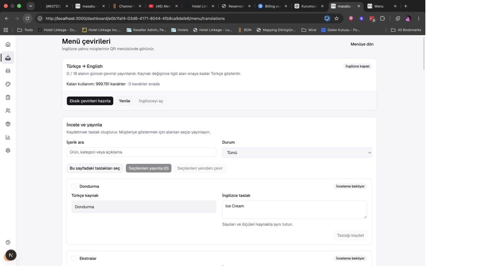
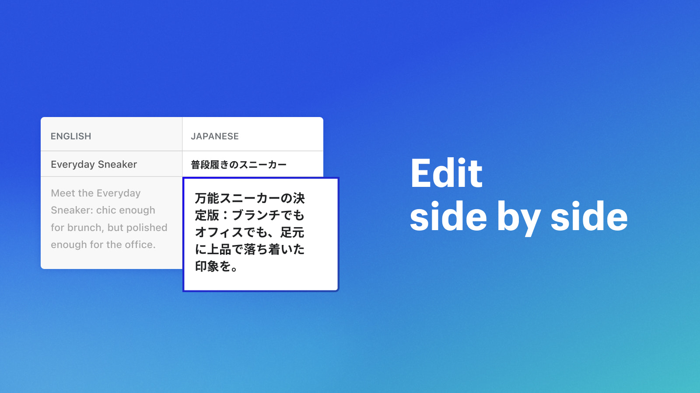
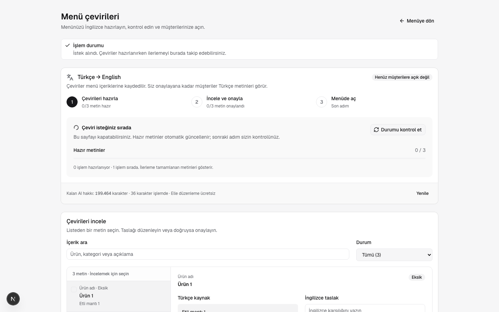
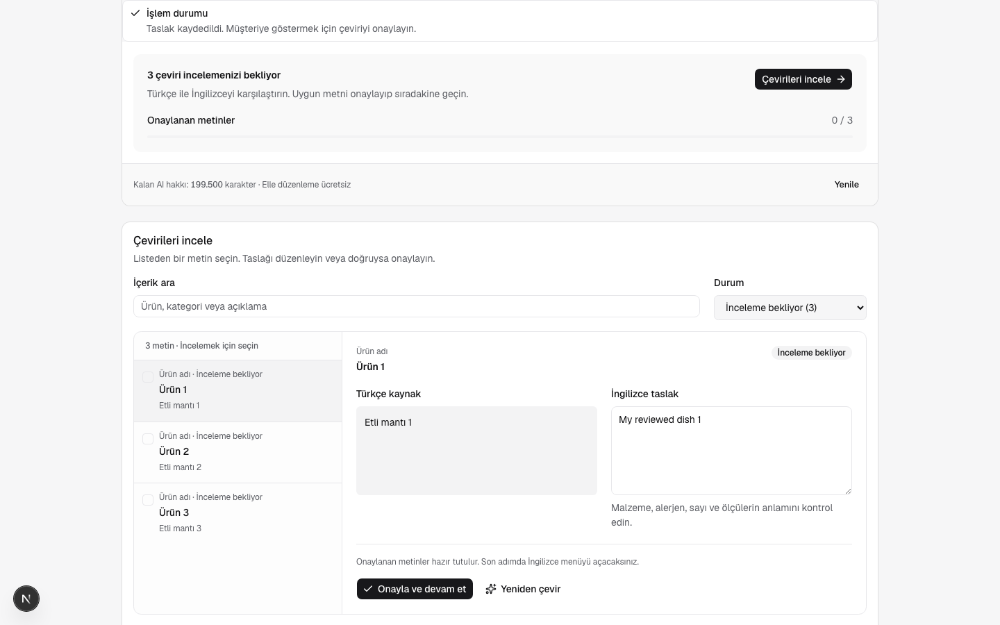
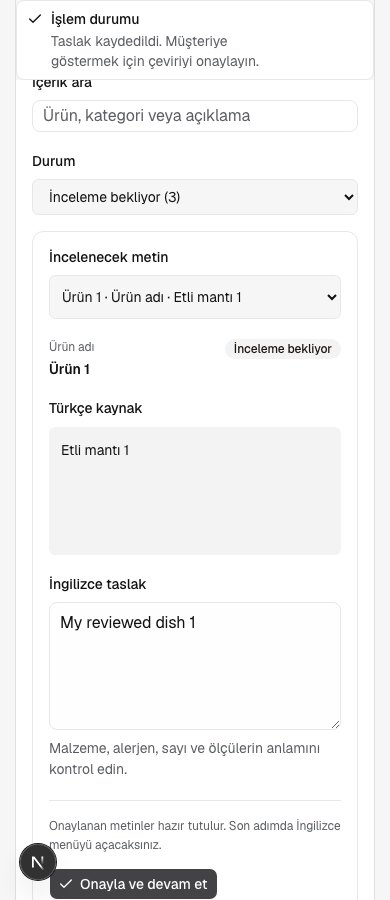
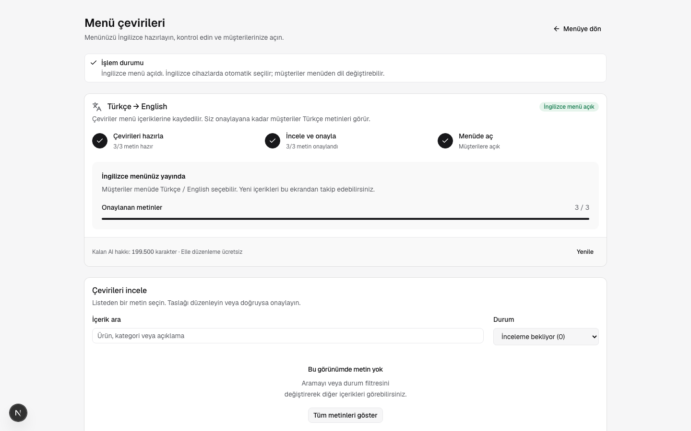
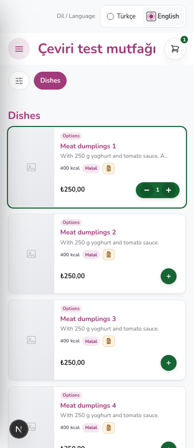
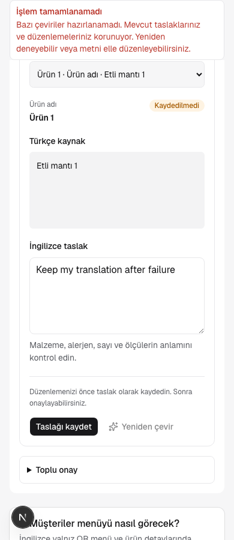

# QR menü çevirileri — akış ve kullanılabilirlik

18 Eylül 2026. Hedef kullanıcı işletme sahibi veya menü düzenleme yetkili ekip. Kapsam: İngilizce taslak üretme, ilerlemeyi anlama, metin inceleme/onaylama, dili müşteriye açma ve müşteri menüsünde dil seçme. Dashboard Türkçe kalır.

## Kanıt ve sınırlar

Kullanıcının ekran görüntüsü ve bu çalışmada açık localhost ekranının görüntüsü incelendi. 18 metnin tamamı inceleme beklerken ana eylem “Eksik çevirileri hazırla” olarak duruyordu. Devre dışı “İngilizceyi aç” düğmesinin yakınında somut sonraki adım yoktu. Her alanın ayrı büyük kart olması aynı ürünün malzeme/miktar/açıklamalarını uzun ve birbirine benzer bir listeye dönüştürüyordu. Sözlüğün aynı sayfada ayrımsız görünmesi, kullanıcının çevirilerin sözlüğe kaydedildiğini düşünmesine yol açtı. Kullanıcının yorumu tek doğrudan kullanıcı kanıtıdır; yaygınlık ölçümü değildir.

Rakip incelemesi oturum açılmış ürün testi değil; resmi ürün belgeleri ve yayınlanmış görseller üzerinden karşılaştırmadır:

- [Shopify Translate & Adapt](https://apps.shopify.com/translate-and-adapt): kaynak/çeviri yan yana editörü. Bu yaklaşım görsel referans olarak kullanıldı; marka veya sayfa tasarımı kopyalanmadı. [Resmi iş akışı](https://help.shopify.com/en/manual/international/translate-adapt-app) otomatik çeviriyi inceleme, kaynak değişikliği ve manuel metinlerin korunmasını açıklıyor.
- [Weglot çeviri listesi](https://support.weglot.com/article/179-strings-details-what-kind-of-strings-information-can-i-get): bir çeviriyi listeden seçip ayrıntısını açma; durum ve geçmişi içerikle ilişkilendirme.
- [Shopify kullanıcı tartışması](https://www.reddit.com/r/shopify/comments/1hjtvav): yeni içerikler için çeviri bakım sürecini baştan tanımlama ihtiyacı. Tek tartışma, sıklık veya temsil iddiası yok.
- Reddit aramasındaki sonuçların çoğu genel çeviri kalitesi veya farklı ürünlerle ilgiliydi; Masabu için sıklık kanıtı sayılmadı. Destek kayıtları/analitik/müşteri görüşmeleri mevcut değil.

## Kararlar

| Öncelik | Sorun / kullanıcı hedefi | Kanıt / güven | Uygulanan karar |
| --- | --- | --- | --- |
| P0 | Düğmeye bastıktan sonra ne olduğunu bilmek | Doğrudan kullanıcı yorumu + kodda polling'in notice temizlemesi; yüksek | İstek gönderiliyor, sırada, hazırlanıyor, incelemeye hazır durumları; otomatik güncelleme; gerçek metin sayıları; işlem sonunda kalıcı açıklama. |
| P0 | Sıradaki işi bilmek | 18 hazır taslağa rağmen üretme butonu; yüksek | Hazırla → incele/onayla → menüde aç adımları; duruma göre tek ana eylem. |
| P1 | Uzun listede doğru içeriği incelemek | Ekran ve rakip örnekleri; orta-yüksek | Masaüstünde kompakt liste + tek editör; mobilde içerik seçici; kaynak/çeviri karşılaştırması; alan türü etiketi. |
| P1 | Kaydetme, onaylama ve dili açmayı ayırmak | Kullanıcının sözlük yorumu; yüksek | İşleme özel sonuç; taslak kaydı ile onayın etkisi; onayla ve sıradakine geç. Toplu onay ikincil bölüm. |
| P1 | Müşterinin doğru dilde başlaması | Kullanıcı isteği; yüksek | Mevcut cihaz dili çözümleme ve menü seçicisi korunur ve tarayıcıda test edilir. Seçilen dil cihaz dilinden öncelikli. |
| P2 | Sözlüğü içerik deposu sanmamak | Doğrudan kullanıcı yorumu; yüksek | Kapalı başlayan “Terim tercihleri · İsteğe bağlı”; yalnız sonraki AI işlemlerini etkilediğini açıklayan metin. |

İlerleme çubuğu tahmini süre veya üretilen token yüzdesi değildir: sunucuda tamamlanmış/güncel metinleri sayar. Sessiz polling düzenleme alanını kilitlemez; kullanıcı komutu geldiğinde eski polling yanıtı uygulanmaz. Hatalarda düzenleme korunur ve son bilinen ilerleme olduğu açıkça belirtilir. Tamamlanan çeviri, insan onayı anlamına gelmez.

## Akış

1. **Hazırla:** kaç metnin eksik olduğu ve kalan AI hakkı görülür. İstek gönderilirken düğme yüklenme durumundadır; kabul edilince sıra/işleme durumu otomatik izlenir.
2. **İncele:** soldan metin veya mobilde seçiciden alan seçilir; Türkçe ve İngilizce karşılaştırılır. Kaydetme taslaktır; “Onayla ve devam et” alanı yayın için onaylar. İngilizce zaten açıksa onayın hemen menüye yansıyacağı belirtilir.
3. **Menüde aç:** tüm görünür metinlerin güncel yayını tamamlanınca sahip İngilizceyi açar. Eksik sayısı ve ekip yetki sınırı görünür.
4. **Müşteri menüsü:** `?lang=` → kayıtlı tercih → desteklenen cihaz dili → Türkçe sırası. English cihazla ilk ziyaret İngilizce; seçiciyle Türkçeye dönüş hatırlanır. Sepet/ödeme diğer ekranlara dil taşımaz.

Bu hafta kapsamı bu dört adımdır. Sonraki pilotta gerçek işletmelerle görev tamamlama süresi, yanlışlıkla yeniden üretme, onay bekleyen içerikte kalma ve dil açma başarısı gözlemlenmeli. Kullanıcı kanıtı olmadan yeni diller veya tüm uygulama i18n kapsamına eklenmez.

Ekran görüntüleri tek başına erişilebilirlik uygunluğu kanıtı değildir. Klavye dil değişimi, kontrol isimleri, görünür durum mesajları, 390px/1440px taşma ve taslak korunması tarayıcı kontrollerinde ayrıca değerlendirilir.

## Uygulama doğrulaması

- 390px ve 1440px izole Playwright akışı geçti: istek → sıra → işleniyor → inceleme → taslak kaydetme → tek tek onay → dili açma. İşleme devam ederken düzenleme korunur; başarısız iş veya kayıt taslağı silmez. Konsol çalışma zamanı hatası yok. [Makine sonucu](result.json).
- İngilizce cihazla ilk açılış, Türkçe tercihin hatırlanması, görünür Türkçe/English radyo seçicisi ve ok tuşlarıyla geçiş doğrulandı. Ürün detayları İngilizce, sepet ve kalıcı sepet adları Türkçe; dil geçişi sepeti değiştirmedi.
- İlgili lint, dashboard/menu typecheck, dil çözümleme domain testleri ve her iki uygulamanın production build kontrolleri başarılı. Derleme ayrı dizinlerde yapıldı; yerel sayfalar çalışır durumda.
- Yönetim akışı deterministik test verisi ve sahte action yanıtlarıyla test edildi. Bu UX kontrolünde işletmenin gerçek taslakları onaylanmadı, dili açılmadı ve ücretli AI çağrısı yapılmadı. Gerçek sağlayıcı doğrulaması üst belgedeki önceki DEV kaydındadır.
- Ekran görüntülerinin masaüstü/mobil yerleşimi görsel olarak incelendi. Tam ekran okuyucu denetimi ve gerçek kullanıcı pilotu bu kontrolün kapsamında değil.

### Sırada ve hazırlanıyor

### Yan yana inceleme

### Menüde açma ve müşteri dili

